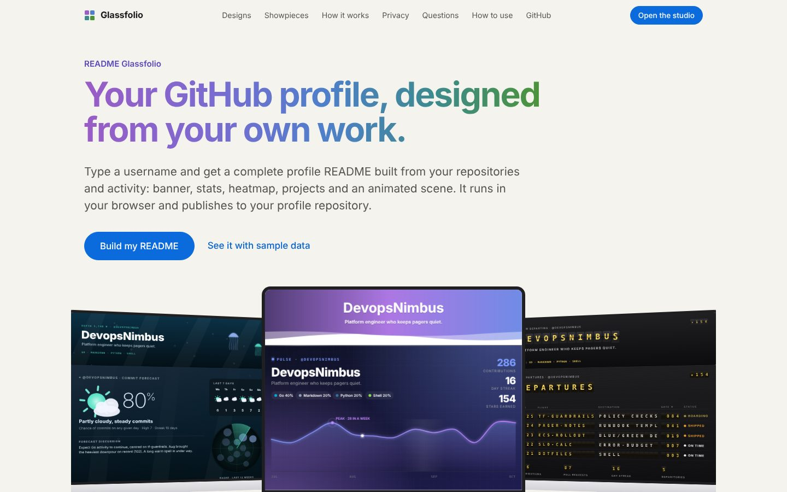
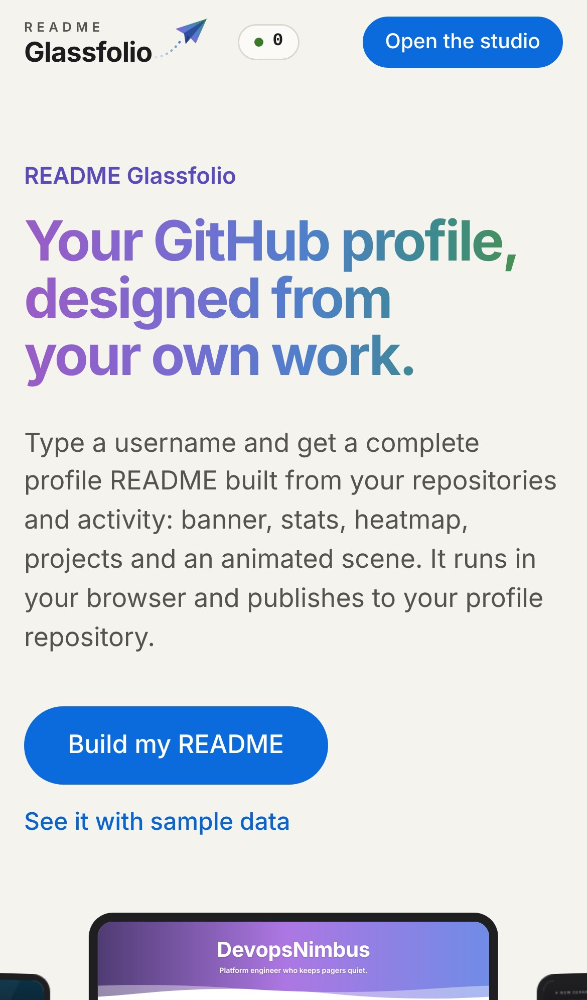
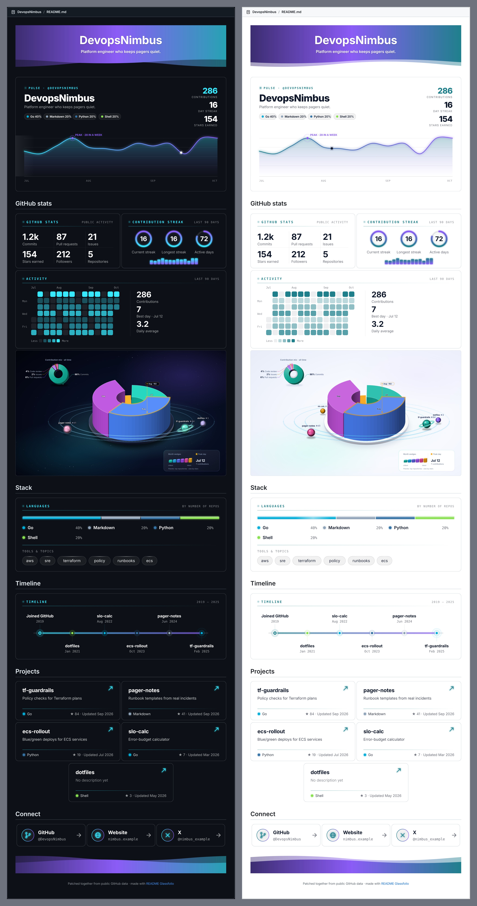

# README Glassfolio

[](https://readme-glassfolio.in/)
[](https://github.com/SandeepKomal/README-Glassfolio/actions/workflows/ci.yml)
[](https://github.com/SandeepKomal/README-Glassfolio/actions/workflows/codeql.yml)
[](https://github.com/SandeepKomal/README-Glassfolio/actions/workflows/pages.yml)
[](https://github.com/SandeepKomal/README-Glassfolio/releases)
[](LICENSE)
[](#quick-start)
[](#quick-start)

Turn any GitHub username into a designed profile README: a banner, stats and streak cards, a contribution heatmap, projects, a timeline and Connect buttons, plus an animated scene drawn from your own data. Pick one of eleven designs or the classic look, check it in a preview that matches GitHub, then publish it to your profile repository in one commit. Turn on daily updates and a small workflow in your own repository keeps the numbers current.

- **Runs in your browser.** No server, no account, no third-party image or stats service. Data comes from `api.github.com` and every image is drawn locally as SVG.
- **Your files, in your repository.** The README and its images live in `<user>/<user>`. The optional daily workflow uses no third-party actions.
- **Three ways to run it.** The website, a command-line tool, and a GitHub Action, all built on the same engine.

**Website:** [readme-glassfolio.in](https://readme-glassfolio.in/) · **Guide:** [step by step with screenshots](https://readme-glassfolio.in/how-to-use.html) (also [in this repository](docs/HOW_TO_USE.md) and as a [PDF](docs/README-Glassfolio-guide.pdf))



<p align="center"></p>

A README made with it from the built-in sample profile, as GitHub shows it on its dark and light pages:



## Quick start

### On the website

1. Create a public repository named exactly like your username (`<user>/<user>`).
2. Open [readme-glassfolio.in](https://readme-glassfolio.in/) and press **Build my README**.
3. Enter your username, choose a design, theme and showpiece, and fill in what you want visitors to read.
4. Press **Publish to GitHub** and paste a fine-grained token (see [Token setup](#token-setup)), or press **Download zip** and upload the files yourself.

### From the command line

Node 18 or later, no dependencies:

```bash
node cli.js https://github.com/DevopsNimbus
node cli.js DevopsNimbus --world observatory --role "Cloud Engineer" --stack "AWS, Terraform"
node cli.js DevopsNimbus --showpiece metro
node cli.js --sample                                   # built-in sample data, no network
GITHUB_TOKEN=github_pat_xxx node cli.js DevopsNimbus   # full-year heatmap and exact streaks
GITHUB_TOKEN=github_pat_xxx node cli.js DevopsNimbus --publish --daily
```

Files are written to `./out/`: `README.md`, `banner.svg` and `cards/`. Run `node cli.js --help` for every option.

### As a GitHub Action

Add a workflow to your profile repository:

```yaml
name: Profile README
on:
  schedule: [{ cron: "17 6 * * *" }]
  workflow_dispatch: {}
permissions:
  contents: write
jobs:
  build:
    runs-on: ubuntu-latest
    steps:
      - uses: actions/checkout@v4
      - uses: SandeepKomal/README-Glassfolio@main
        with:
          world: observatory        # any design, or leave empty for the classic look
          # showpiece: yearcode     # any showpiece, or none
          # config: .readme-patch/config.json
```

Inputs: `username` (defaults to the repository owner), `world`, `showpiece`, `theme`, `config`, `out`, `commit` (default `true`; commits only when something changed) and `token` (defaults to the workflow token). Inputs reach the shell as environment variables.

## Publishing

Every card is an SVG file stored next to `README.md` in `<user>/<user>`. GitHub shows images stored in a repository, so the README and its images always travel together.

| | What you do | Needs |
| --- | --- | --- |
| **Publish** | Press *Publish to GitHub* and paste a token. One commit lands in `<user>/<user>`. | A fine-grained token |
| **Download zip** | Upload everything in the zip to `<user>/<user>`. A missing image shows as broken. | Nothing |

Publishing refuses to write to anyone else's profile, handles a brand-new empty repository, and explains what's wrong when the repository is missing or the token lacks permission.

### Token setup

One fine-grained token covers reading your data, publishing and adding daily updates. Create it at [github.com/settings/personal-access-tokens/new](https://github.com/settings/personal-access-tokens/new):

- **Repository access:** *Only select repositories*, and pick `your-username/your-username`.
- **Repository permissions:**

| Permission | Setting | Why |
| --- | --- | --- |
| Contents | Read and write | Commit the README, banner and cards |
| Workflows | Read and write | Add the daily-update workflows (only needed for daily updates) |
| Metadata | Read-only | Set automatically by GitHub |

With a classic token, tick `public_repo`, plus `workflow` for daily updates. If the token can write files but not workflows, the README and cards are still published and the page says what to add.

### Daily updates

A published README is a snapshot. With *Keep my stats fresh every day* (on by default once your own profile is loaded, or `--daily` from the terminal), publishing also adds:

- `.github/workflows/update-readme.yml`: runs once a day, at a time derived from your username, and whenever you press *Run workflow*.
- `.github/workflows/update-universe.yml`: when the 3D universe is on, redraws `cards/universe.svg` every 6 hours.
- `.readme-patch/`: your saved choices (`config.json`) and a copy of the generator, so the repository is self-contained.

Each run reads your public GitHub data, rebuilds `README.md` and the images, and commits only if something changed, as `github-actions[bot]`. Good to know:

- The workflows have no `uses:` lines, only shell steps that run the copy in `.readme-patch/`. Their only permission is `contents: write`, they use no secrets, and they only talk to `api.github.com`.
- `README.md`, `banner.svg`, `banner-light.svg` and the `.svg` files in `cards/` are rewritten every run. Change `.readme-patch/config.json`, or publish again from the website, instead of editing them by hand. Nothing else in the repository is touched.
- If GitHub's activity can't be read on a given day, the run stops without changing anything.
- `config.json` holds your choices (theme, job title, skills, LinkedIn name), so it's visible in your public repository.
- GitHub pauses scheduled workflows in a public repository after 60 days without activity; re-enable them in the Actions tab.
- To stop, delete the workflow files or disable them in the Actions tab. Your README stays as it is.

## Designs, themes and showpieces

Choose in order: a **design**, then a **theme**, then a **showpiece**. Each choice follows the ones above it, so the whole README matches by default.

### Designs

A design restyles everything from banner to footer: every card, the fonts, the colours in light and dark, an animated divider in place of each section heading, the footer and a matching showpiece. Use `--world <name>`, or leave it out for the classic glass look.

| Design | Idea | Showpiece |
| --- | --- | --- |
| `airport` | Split-flap departure boards, amber on black | Departures board |
| `transit` | Metro signage, with a stripe in your language colours | Metro map |
| `broadsheet` | A newspaper with your name as the masthead | Front page |
| `observatory` | A star chart; contributions as twinkling stars | Constellation sky |
| `botanical` | A herbarium; leaves for contributions | Code garden |
| `atlas` | An antique sea chart with a compass rose | Passport |
| `museum` | A gallery: gilded frame, brass placards, velvet ropes | Holo trading card |
| `ink` | Sumi-e on washi, with a vermilion seal | Ink scroll |
| `periodic` | A lab notebook with element tiles | Vital signs |
| `abyss` | The deep sea: light rays, plankton, sonar | Commit forecast |
| `voxel` | An isometric city of contribution blocks, with a hover-bot | Block city |

### Themes

`auto` picks colours from the username, or choose `aurora`, `cyber`, `sunset`, `emerald`, `royal`, `graphite` or the light `paper`. *Custom* (or `--colors "#ff8800,#00c2a8"`) takes any two colours and adjusts them to stay readable. In a design, `auto` keeps the design's own colours; any other theme recolours all of it.

### Showpieces

One full-width animated scene under the banner, drawn from your repositories and activity. On *Auto* you get the look's own scene; `--showpiece none` leaves it out.

| Showpiece | Your data becomes |
| --- | --- |
| `departures` | A split-flap board: featured repos as flights, with a status from their activity |
| `holo` | A collectible trading card, with your next repos as a fanned deck |
| `metro` | A metro map: languages as lines, repos as stations by year |
| `vinyl` | An album: projects as the tracklist, months as an equaliser |
| `vitals` | A bedside monitor: commits as the ECG, your streak as the heart rate |
| `garden` | Repos as flowers sized by stars; the grass is your contribution graph |
| `yearcode` | Year in Code: six tiles, including a coding personality |
| `newspaper` | *The Daily Commit*: your year as the headline, your top repo as the lead story |
| `passport` | An open passport with a visa stamp for every language |
| `constellation` | Languages as constellations, repos as stars |
| `weather` | A commit forecast with a radar of recent weeks |
| `pulse` | Your year as one glowing waveform (the classic look's own) |
| `scroll` | An ink-wash landscape of your year (Ink's own) |
| `city` | An isometric city of recent contributions (Voxel's own) |

Every showpiece sits in the same frame as your cards and uses your theme's colours.

## More options

- **For employers.** *Open to*, a *Résumé* link (https only) and *Certifications* make a card right under the banner. *Recruiter summary* adds three lines written from your data, *Skills with proof* backs each skill with the repos that use it, and *Impact numbers* add a metrics strip to project cards. CLI: `--open-to`, `--resume`, `--certs`, `--summary`, `--proof`, `--impact "api: 40+ users, 99.9% uptime; web: 3x faster"`.
- **Day and night.** On by default: every image gets a light twin, and GitHub shows each visitor the set that matches their light or dark mode. `--no-adaptive` writes one set.
- **Motion.** Gentle CSS loops inside the SVGs, with no scripts. Visitors who prefer reduced motion see the still image, which is always the finished design. `--no-animation` turns motion off.
- **Layouts.** `showcase` (project cards) or `changelog` (projects as release notes).
- **Sections.** Banner, wave header and footer, cards, heatmap, timeline, projects, Connect links, language bars, a language donut, *Recently pushed* and the 3D contribution universe can each be switched on or off.
- **Section order and featured projects.** `--order projects,stats,connect` and `--featured api,web,docs` (up to six).
- **3D contribution universe.** Your year as a 3D pie of months with your top repos orbiting as planets, plus your contribution mix. Ported from [Git3D Universe](https://github.com/SandeepKomal/Git3D-Universe) (MIT). `--universe-style theme` matches your theme.
- **Share links.** *Copy share link* makes a URL like `?user=DevopsNimbus&theme=cyber&role=Cloud+Engineer` that reopens the same setup.
- **Downloads.** Every image as SVG or PNG, all PNGs as a zip, and a 1280×640 share image for LinkedIn or X (`--share-image`).
- **Footer credit.** The README ends with "made with README Glassfolio". `--no-credit` removes it.

## How the numbers are fetched

| | Without a token | With a token |
| --- | --- | --- |
| Commits, PRs, issues, code reviews | Search API totals (public, all time) | GraphQL, past year |
| Heatmap, streaks and active days | Public events feed, up to the last 90 days | Contribution calendar, past year |
| Requests per profile | About 9 (60 per hour without a token) | 3 |

Without a token the streak is a lower bound, because GitHub exposes only about 90 days of public events. A token needs no scopes for public data and is never stored.

## Limits

- Only public data is used, unless a token gives access to your contribution calendar (which follows your GitHub setting for private contributions).
- GitHub shows a README about 360 px wide on a phone. Paired cards stack at close to full size; wide cards (heatmap, languages, timeline, banner) shrink, so their small text is harder to read. The *Phone* preview shows exactly this.
- Motion is CSS inside each SVG. GitHub's image proxy allows it; a viewer that blocks it sees the still image.
- Language statistics count repositories per primary language, not lines of code.
- The daily workflow falls back to the public activity feed (about 90 days) if GitHub's workflow token can't read the contribution calendar. Run it once from the Actions tab after publishing and check the result.

## Security

The website is safe to paste a token into, and the browser enforces it:

- A strict Content-Security-Policy allows scripts only from the site itself and network requests only to the site and `api.github.com`. There are no inline scripts or styles and no `eval`.
- The page never inserts untrusted HTML. The preview builds elements from a whitelist.
- Tokens stay in memory, are sent only to `api.github.com`, and are never saved or put in a share link.
- `test/page.test.js` fails if an inline script, `innerHTML`, `eval`, a new network host or a stored token is added.

See [SECURITY.md](SECURITY.md) for the full model and how to report a vulnerability.

## Development

The site is static files with no build step, and the project has no runtime dependencies.

```bash
npm run serve        # then open http://localhost:8080
npm test             # node:test, no dependencies
```

```
index.html        The home page and studio
how-to-use.html   The step-by-step guide
privacy.html      Privacy policy
terms.html        Terms of service
css/style.css     Styles for every page
js/core.js        Engine: parses input, builds the model, writes the README and banner (no network, no DOM)
js/cards.js       Draws the cards as SVG
js/worlds.js      Draws the eleven designs: frames, headings, dividers, banners and footers
js/showpieces.js  Draws the fourteen showpieces
js/universe.js    Draws the 3D contribution universe
js/github.js      Reads profile, repositories and activity from the GitHub API
js/preview.js     Renders the README the way GitHub does (whitelist-based)
js/publish.js     Commits the files to <user>/<user> in one commit
js/automation.js  Writes the daily-update workflows, config and generator copy
js/zip.js         Small ZIP writer for downloads
js/app.js         Connects the studio to the engine
js/site.js        The home page's showcase, story and scroll effects
cli.js            Command-line version
action.yml        The GitHub Action
test/             Tests
tools/            Optional tools that need Playwright (see below)
docs/             Guide, screenshots and deployment notes
```

Optional tools, which need Playwright (`npm install --no-save playwright && npx playwright install chromium`):

```bash
node tools/layout-fuzz.js        # renders cards with extreme names and checks that no text overlaps
node tools/day-night-check.js    # checks that the light and dark image sets swap together
node tools/build-guide-pdf.js    # rebuilds docs/README-Glassfolio-guide.pdf from docs/HOW_TO_USE.md
```

The site deploys to GitHub Pages from `.github/workflows/pages.yml`. See [docs/GITHUB_PAGES.md](docs/GITHUB_PAGES.md).

Some internal names come from the project's first name, *Patch your profile*: the `.readme-patch/` folder in profile repositories and the browser storage key `patch-your-profile.v1`. They stay as they are so existing profiles and saved settings keep working.

## Contributing

Issues and pull requests are welcome. See [CONTRIBUTING.md](CONTRIBUTING.md).

## License

[MIT](LICENSE). The 3D contribution universe is ported from [Git3D Universe](https://github.com/SandeepKomal/Git3D-Universe), also MIT.
