# How to use README Glassfolio

Turn your GitHub profile into a designed, self-updating README in about ten minutes. You'll create one repository, make a token that can write to it, build your README in the studio and publish it.

**Website:** [readme-glassfolio.in](https://readme-glassfolio.in/) · **This guide as a page:** [readme-glassfolio.in/how-to-use.html](https://readme-glassfolio.in/how-to-use.html)

You need:

- a GitHub account,
- a public repository named exactly like your username (step 1),
- a fine-grained token that can write to that one repository (steps 2 to 8).

Everything runs in your browser. The token is sent only to GitHub and is never stored.

---

## Part 1: Create your profile repository

### Step 1. Create `your-username/your-username`

On GitHub, click **+ → New repository**. Name it exactly like your username; GitHub confirms it's the special repository that shows on your profile. Set it to **Public**, switch **Add README** on, then click **Create repository**.

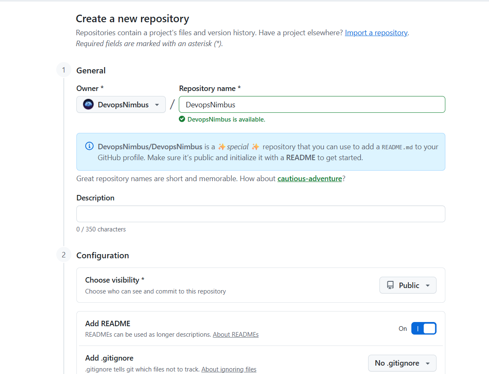

---

## Part 2: Create a token

README Glassfolio needs permission to commit the README, its images and the daily-update workflows to your profile repository. A fine-grained token limited to that one repository is the safest way to give it.

### Step 2. Open Settings

Click your avatar in the top right and choose **Settings**.

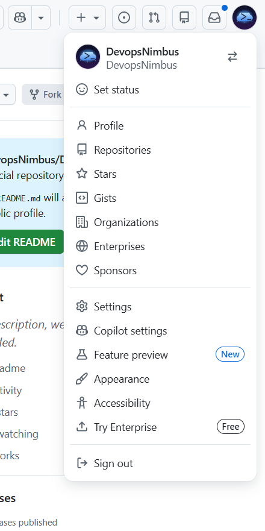

### Step 3. Open Developer settings

Scroll to the bottom of the left menu and click **Developer settings**.

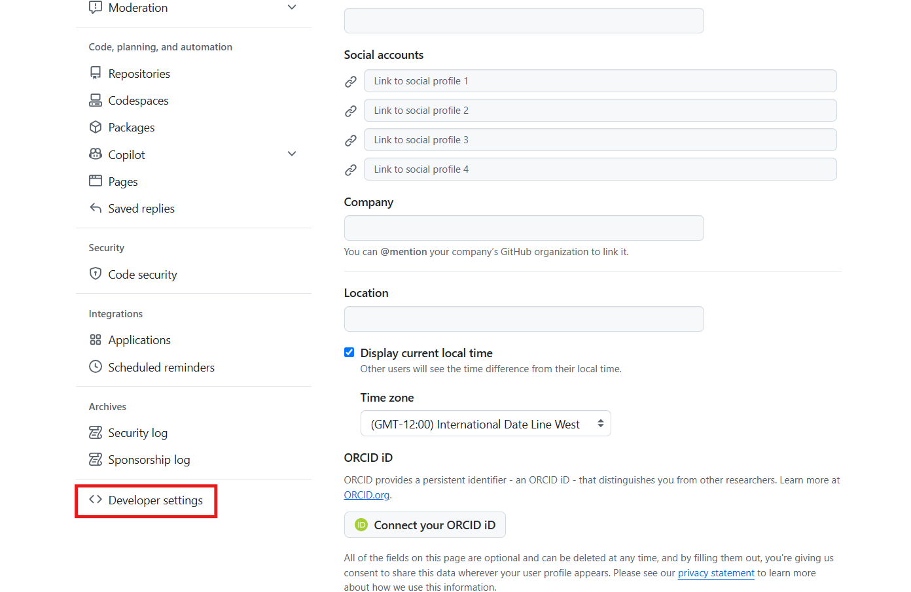

### Step 4. Fine-grained tokens

Open **Personal access tokens → Fine-grained tokens** and click **Generate new token**.

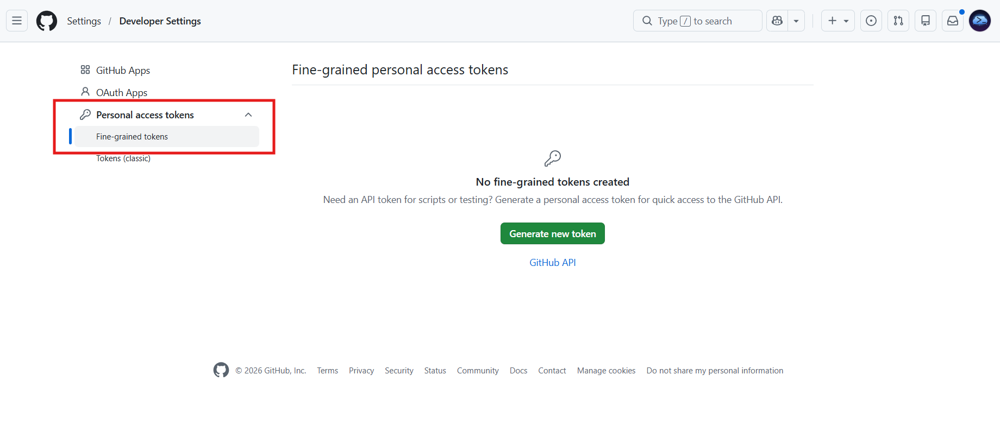

### Step 5. Name it and pick an expiry

Give the token a name you'll recognise, for example `profile-readme`. Keep **Resource owner** as your own account and choose an expiry. You only need the token when you publish; the daily updates use GitHub's own temporary token, so an expired token doesn't stop them.

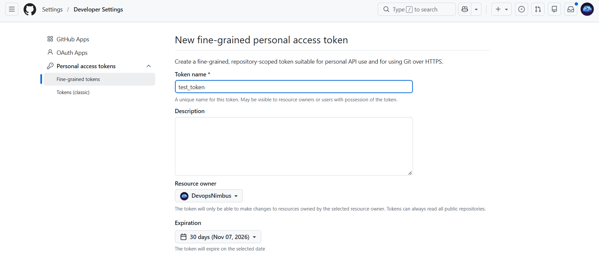

### Step 6. Only your profile repository

Under **Repository access**, choose **Only select repositories** and tick **your-username/your-username**.

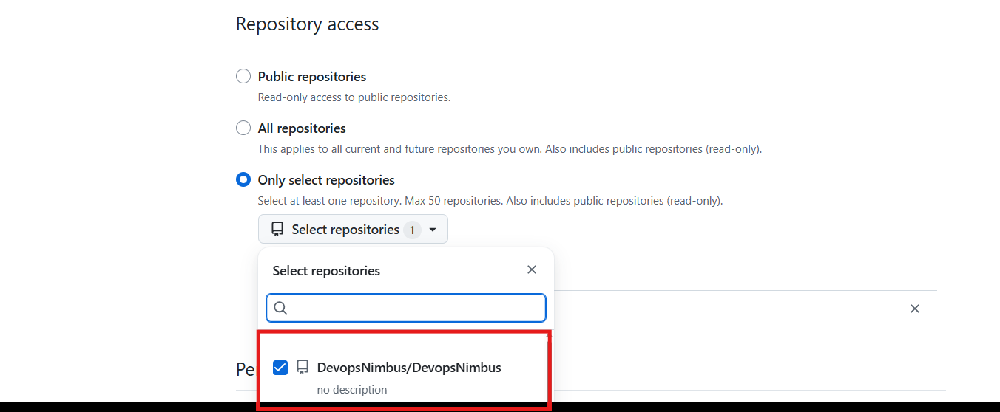

### Step 7. Contents and Workflows: Read and write

Under **Permissions**, click **Add permissions** and set:

| Permission | Access | Why |
| --- | --- | --- |
| **Contents** | Read and write | Commit the README, banner and cards |
| **Workflows** | Read and write | Add the daily-update workflows in `.github/workflows/` |
| Metadata | Read-only | Added by GitHub automatically |

Nothing else is needed. Then click **Generate token**.

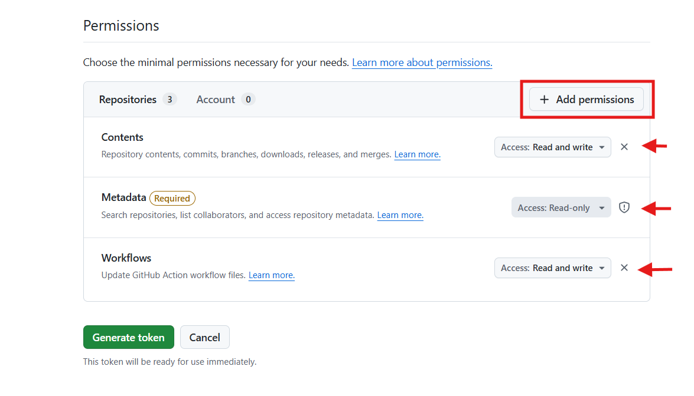

> Without **Workflows: Read and write**, your README and cards are still published, but the daily updates are left out and the page tells you exactly what to add. You can edit the token's permissions later; you don't need a new one.

### Step 8. Copy the token

Copy the token now: GitHub shows it only once. Keep it private and don't paste it anywhere except README Glassfolio.

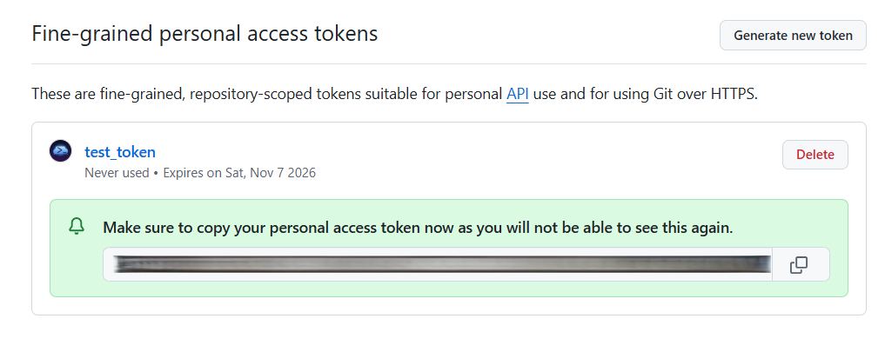

---

## Part 3: Make your README

### Step 9. Open README Glassfolio

Go to [readme-glassfolio.in](https://readme-glassfolio.in/) and press **Build my README**. It takes you to the studio with the cursor in the username box. The studio shows a sample profile until you load yours.

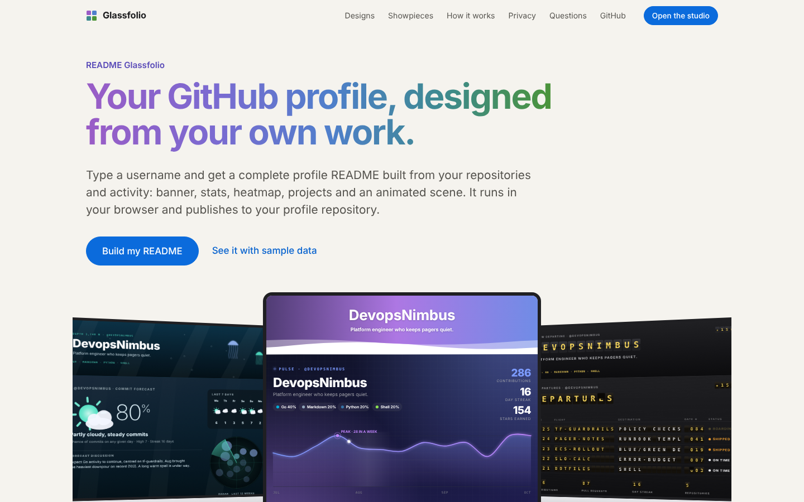

### Step 10. Enter your username and build

In **1. Your GitHub username or profile link**, paste your profile link (for example `https://github.com/your-username`) or just your username, then press **Build my README**. The preview below fills with your own repositories and activity.

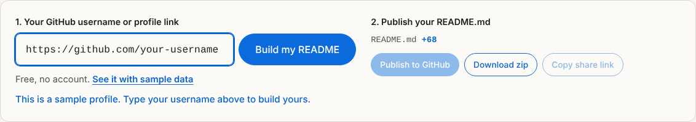

### Step 11 (optional). Exact data

Open **Exact data: add a token** at the bottom of the options and paste the same token, then press **Build my README** again. With a token, the heatmap and streaks cover the **past year** instead of the last 90 days of public activity, and the same token is used for publishing, so you only paste it once.

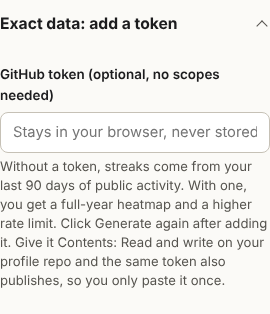

### Step 12. Choose the look

Under **Look**, choose in order:

- **Design**: the classic glass look, or one of eleven designs that restyle the whole README from banner to footer.
- **Theme**: a colour theme, or **Custom** with your own two colours. In a design, Auto keeps the design's own colours; any other theme recolours all of it.
- **Showpiece**: the animated scene under your banner. Auto uses the look's own scene; None leaves it out.

The preview updates as you choose, and the **Light** and **Dark** switches above it show both versions.

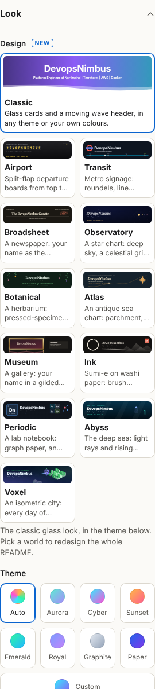

### Step 13. About you

Fill in what you'd like visitors to read first:

- **Job title**: shown right after your name.
- **Tagline**: a smaller line under it.
- **Skills and tools**: comma separated; the first ones also appear in the header.
- **LinkedIn**: adds a LinkedIn button to Connect.

**For employers** is optional too: what you're open to, a résumé link, certifications, a recruiter summary, skills backed by your repositories, and impact numbers for your projects.

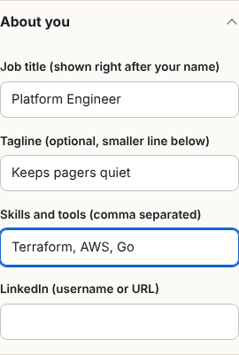

### Step 14. Projects and daily updates

Under **Order & projects**, move sections up or down and tick up to six repositories to feature, in the order you want them. Tick none to show your most-starred ones.

Under **Daily updates**, leave **Keep my stats fresh every day** ticked. It adds the workflows that refresh your profile automatically. It becomes available once your own profile is loaded.

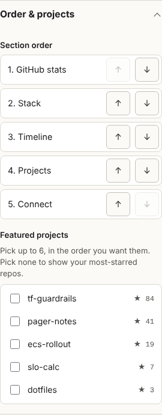

### Step 15. Sections

Under **Sections**, tick or untick any part of the README. The wave header and footer, visual cards, contribution heatmap, timeline, projects, Connect links, the 3D contribution universe and the footer credit are on by default. **Recently pushed** and the **Language donut chart** are off until you tick them.

The **Make it even better** box lists quick wins, such as a job title or repository descriptions. Click a tip to jump to the field that fixes it.

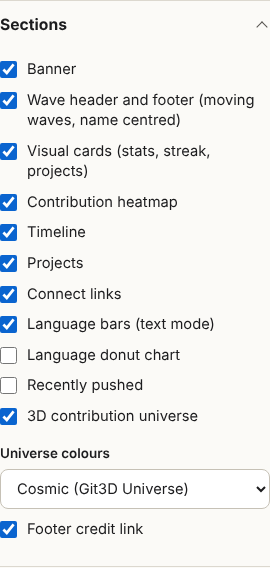

---

## Part 4: Publish

### Step 16. Open the publish panel

In **2. Publish your README.md**, press **Publish to GitHub**. The panel says which repository it will commit to and which permissions the token needs.

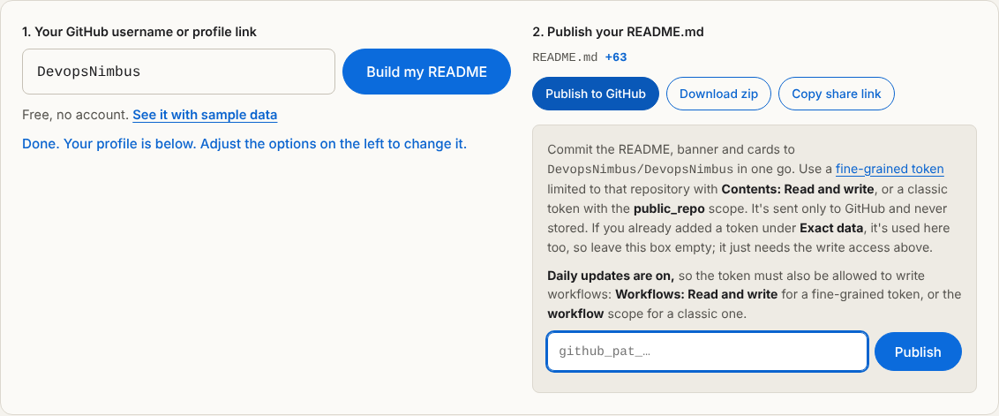

### Step 17. Paste the token and publish

Paste your token and press **Publish**. If you already added it under Exact data (step 11), you can leave this box empty.

### Step 18. Done

You'll see **Published N files** with the time of your first daily run, and links to your profile and to the Actions tab.

> If it says **Daily updates were NOT added**, the token is missing Workflows: Read and write (step 7). Your README is live anyway; fix the token and publish again to add the daily updates.

---

## Part 5: Check your profile

### Step 19. Your profile repository

Your repository now contains:

- `README.md`, `banner.svg`, `banner-light.svg` and a `cards/` folder: the profile and its images, in a dark and a light version.
- `.github/workflows/update-readme.yml`: rebuilds everything once a day.
- `.github/workflows/update-universe.yml`: refreshes the 3D universe every 6 hours.
- `.readme-patch/`: your saved choices (`config.json`) and the generator the workflows run.

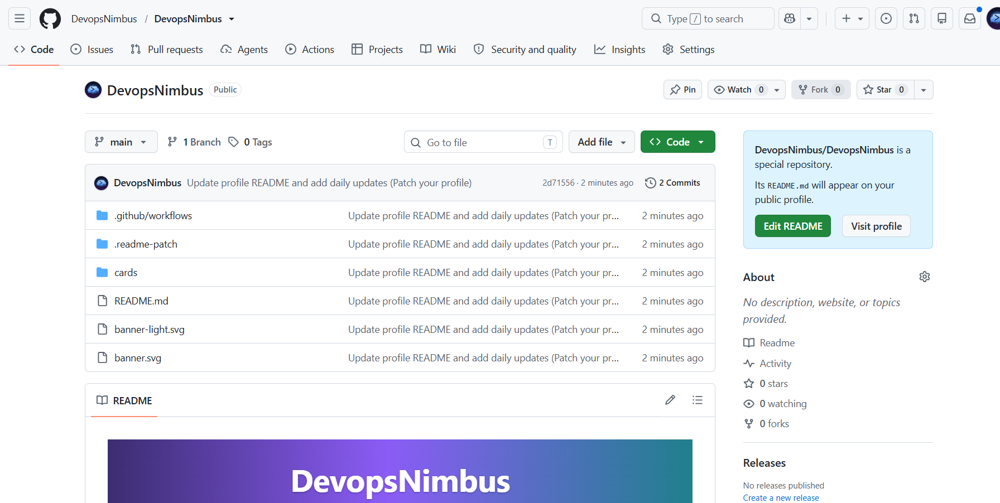

### Step 20. Your profile

Open your profile. Visitors on GitHub's light theme see the light version, and visitors on the dark theme see the dark one.

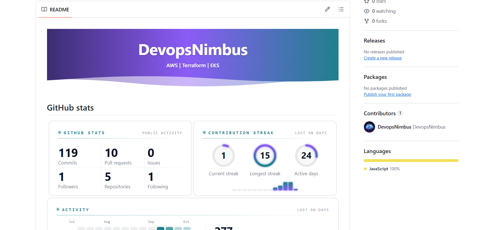

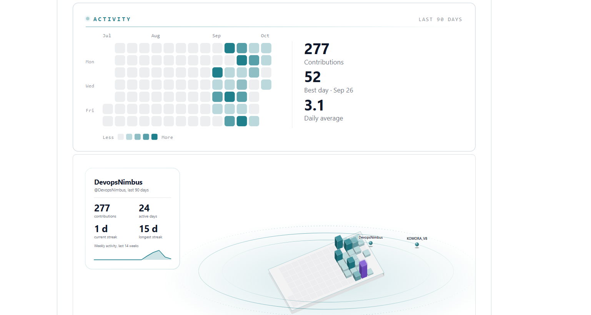

### Run the daily update now (optional)

Open your repository's **Actions** tab, choose **Update profile README** and press **Run workflow** to see it work without waiting. A successful run makes an **Update profile stats** commit when your numbers have changed.

---

## Change something later

Open the studio again, build with your username, change the options and publish again. The daily workflows always use your latest choices. Don't edit `README.md` or the images by hand: the next daily run rebuilds them from your choices.

## Troubleshooting

| What you see | What to do |
| --- | --- |
| **Daily updates were NOT added** | Give the token Workflows: Read and write (step 7) and publish again. The message names what's missing for your token. |
| **The token can't write to this repository** | The token needs Contents: Read and write on `your-username/your-username`, and the repository must be in its Repository access list (step 6). |
| **Create a public repository named …** | Create the profile repository first (step 1). It must be public and named exactly like your username. |
| **GitHub's rate limit is used up** | Wait a little, or add your token under Exact data (step 11). |
| **The page looks like an older version** | Press Ctrl+Shift+R (Cmd+Shift+R on a Mac). The page also reloads itself once when a newer version has been deployed. |
| **The profile still shows old images** | GitHub caches images for a few minutes. Wait, then refresh the profile. |
| **The daily workflow stopped** | GitHub pauses scheduled workflows in a public repository after 60 days without activity. Re-enable it in the Actions tab. |

To stop the daily updates, delete the two files in `.github/workflows/` or disable them in the Actions tab. Your README stays as it is.
